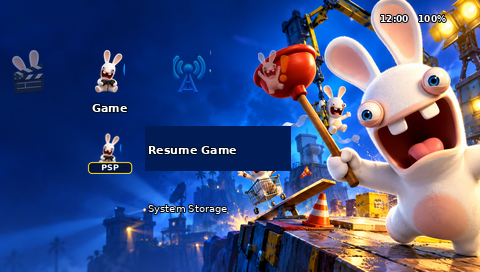
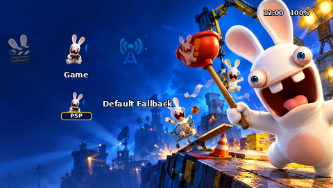

# Rayman Raving Rabbids — PSP Theme

**An unofficial fan-made PSP theme by Amir Saeid Dehghan.**

[English](#english) | [فارسی](#فارسی)

> **Preview notice:** All interface images in this repository are illustrative composites, not screenshots from a real PSP or emulator. The PTF structure and images were validated, but the theme has not been tested on physical hardware or an emulator.

## English

A colorful fan theme inspired by *Rayman Raving Rabbids* (2006), created for the PSP's standard PTF theme format. It includes a 480 × 272 wallpaper, custom category and menu artwork, focus graphics, preview images, and source assets.

### Download and installation

Download the [PTF theme](Release/Rayman_Raving_Rabbids_Universal_PSP.ptf). Connect the PSP using **Settings → USB Connection** and copy it into `PSP/THEME/` on the selected storage. For PSP Go internal storage this is `ef0:/PSP/THEME/`; for Memory Stick it is `ms0:/PSP/THEME/`. Eject the device, disconnect USB, then select **Settings → Theme Settings → Theme → Rayman Raving Rabbids**. Select the default theme in the same menu to restore it.

PSP-1000, 2000, 3000, Go and Street, including firmware 6.60/6.61, are intended targets. No custom firmware or CXMB plugin is intended. **Actual compatibility on these devices is unverified.** PSP Go entries use the standard fallback icon according to PTF Studio's mapping.

### Previews

These are illustrations of the interface rather than captures from a console:

| PSP Go | PSP-3000 |
| :---: | :---: |
|  |  |

[Settings](Previews/Settings_Preview.png) · [Game](Previews/Game_Preview.png) · [Music](Previews/Music_Preview.png) · [Theme selection](Previews/Theme_Selection_Preview.png) · [Wallpaper](Wallpapers/Main_Wallpaper.png)

### Files and validation

- [`Release/`](Release/) — PTF file.
- [`Wallpapers/`](Wallpapers/) and [`Icons/`](Icons/) — PSP-sized artwork.
- [`Source/`](Source/) — high-resolution flattened artwork, individual image inputs, project index, generation script, and palette correction patch.
- [`Documentation/`](Documentation/) — installation, asset specifications, compatibility, and detailed validation.

The PTF was built with a locally patched version of [LibPSPThemes](https://github.com/GeofrontTeam/LibPSPThemes). All 72 GIM resources were independently decoded with code from [PTF Studio](https://github.com/S1implyBlue/PTF-Studio) and matched the intended image data. File parsing and image checks cannot establish actual firmware or device compatibility. See the [validation report](Documentation/Validation_Report.md).

First-level icons reuse category artwork with abbreviated labels; second-level icons are generic. High-resolution source images are flattened bitmaps rather than layered originals. This is unofficial fan art and is not affiliated with or endorsed by Ubisoft or Sony. Rayman and Rabbids are trademarks of Ubisoft; PlayStation and PSP are trademarks of Sony.

## فارسی

یک تم طرفداری و غیررسمی با الهام از بازی **Rayman Raving Rabbids (2006)** برای رابط کاربری PSP. این پروژه شامل والپیپر با ابعاد ۴۸۰ × ۲۷۲، آیکون‌های دسته‌بندی و منو، تصاویر فوکوس و فایل‌های منبع است.

### دانلود و نصب

۱. [فایل PTF تم را دانلود کنید](Release/Rayman_Raving_Rabbids_Universal_PSP.ptf).
۲. کنسول را با USB وصل کنید و **Settings → USB Connection** را انتخاب کنید.
۳. فایل را در پوشهٔ `PSP/THEME/` کپی کنید. برای حافظهٔ داخلی PSP Go مسیر `ef0:/PSP/THEME/` و برای Memory Stick مسیر `ms0:/PSP/THEME/` است. اگر پوشه وجود ندارد، آن را بسازید.
۴. حافظه را به‌صورت ایمن خارج و کابل را جدا کنید. سپس از **Settings → Theme Settings → Theme** تم **Rayman Raving Rabbids** را انتخاب کنید.
۵. برای بازگشت به ظاهر اصلی، تم پیش‌فرض را از همان بخش انتخاب کنید.

این تم برای PSP-1000، PSP-2000، PSP-3000، PSP Go و PSP Street و فریم‌ورهای 6.60 و 6.61 در نظر گرفته شده است و هدف آن استفاده از فرمت استاندارد PTF بدون CXMB است. **سازگاری عملی با این دستگاه‌ها هنوز روی کنسول واقعی یا شبیه‌ساز آزمایش نشده است.**

### پیش‌نمایش و فایل‌ها

تصاویر این صفحه و پوشهٔ [`Previews/`](Previews/) شبیه‌سازی تصویری هستند و اسکرین‌شات واقعی دستگاه نیستند. فایل نصب در [`Release/`](Release/)، آیکون‌ها و والپیپر در [`Icons/`](Icons/) و [`Wallpapers/`](Wallpapers/) و سورس‌ها در [`Source/`](Source/) قرار دارند.

ساختار فایل و ۷۲ تصویر GIM داخل آن بررسی شده‌اند؛ این بررسی جای تست روی دستگاه را نمی‌گیرد. جزئیات در [گزارش اعتبارسنجی](Documentation/Validation_Report.md) موجود است. فایل‌های تصویری با وضوح بالا تخت هستند و لایه‌های قابل ویرایش ندارند.

**سازنده: Amir Saeid Dehghan**  
این پروژه فن‌آرت غیررسمی است و وابستگی رسمی به Ubisoft یا Sony ندارد.
